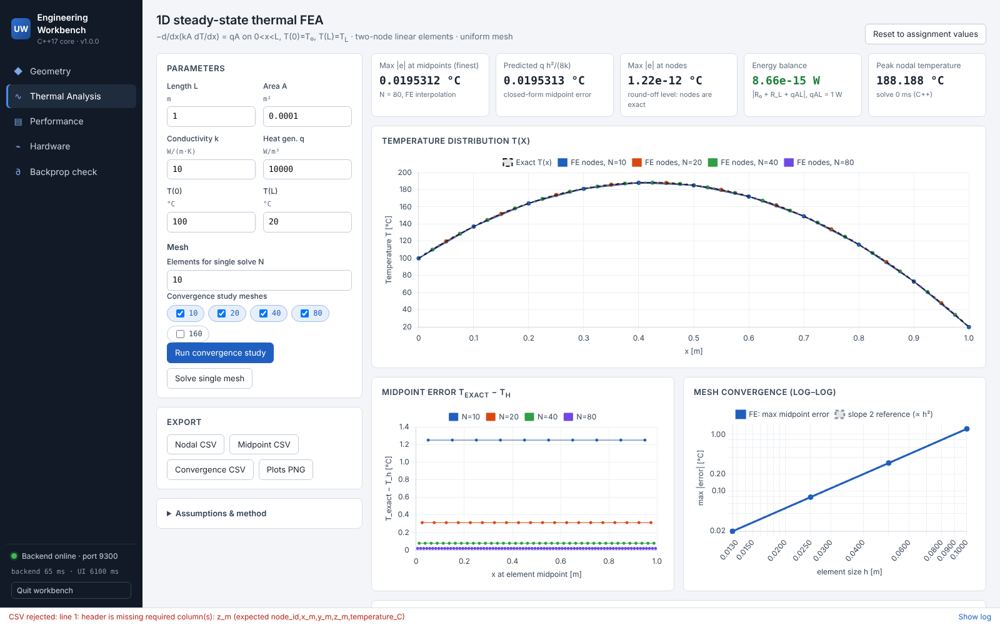

# Unified Engineering Workbench

PASS Science Works R&D Internship 2026–2027 common assignment.
A small engineering workbench that imports CAD/result data, solves a 1D thermal
FEA problem, runs it as a multicore batch, models a host-connected embedded bench
and checks a hand-derived backpropagation, with all backend logic in **C++17**.



## 1. Run it (Windows 11 x64, one click)

1. Extract `CandidateID_Workbench.zip` anywhere (Desktop, Downloads, USB stick).
2. Double-click **`Launch.exe`**.

A console window titled "backend log" opens and the workbench appears in a
Microsoft Edge app window (Edge is part of Windows 11). If Edge cannot be started,
the default browser opens instead. Close the console window or press
**Quit workbench** to stop.

No terminal commands, PowerShell, administrator rights, package installation,
internet connection or first-run build are needed. `Launch.exe` is a single
statically linked executable that only imports Windows system DLLs
(KERNEL32, USER32, SHELL32, WS2_32, msvcrt); the web UI is compiled into it.

If Windows SmartScreen says "Windows protected your PC" (the exe is unsigned and
came from a ZIP), click **More info → Run anyway**. The backend listens on
127.0.0.1 only, so no firewall prompt is expected.

Verified on the target laptop: Windows 11 build 26300, Intel Core i5-14450HX
(double-click from Explorer; backend ready 388 ms, UI ready 705 ms after process
start). See `docs/walkthrough/windows_native/`.

### Run from VS Code or Google Antigravity
Open the extracted folder, trust the workspace, then press **Ctrl+Shift+B**
(task "Run Workbench (Launch.exe)") or **F5** ("Run Workbench (packaged)"). Both run
the same packaged `Launch.exe`; no extension is required. Details:
`config/editor/README.md`.

### Packaged tools
* `bin\RunTests.cmd`: runs the C++ test suite (62 cases) natively.
* `bin\RunBenchmark.cmd`: headless 1 to 4 worker benchmark, writes
  `results\benchmarks\this_pc\`.

## 2. What is in the application

| View | What it does (C++ does the work, the browser only draws) |
|---|---|
| **Geometry** | Open or load an example ASCII STL → 3D triangles with rotate/pan/zoom, fit-to-view, isometric/top, wireframe, bounds/area/parse time. Switch to **Nodal temperatures (CSV)** → coloured 3D point cloud, °C legend, click a node to inspect id/x/y/z/T. Malformed files are rejected with the line number and the previous model is kept. |
| **Thermal Analysis** | 1D steady FEA of the assignment rod; editable parameters with validation; convergence study N = 10, 20, 40, 80 (+160) vs the exact solution; midpoint errors via FE interpolation; log-log convergence; energy balance; CSV and PNG export. |
| **Performance** | Batch of independent thermal solves; serial loop vs bounded `std::thread` pool with 1 to 4 workers (capped at logical CPUs); warm-up + 5 runs; median, speedup, efficiency, max abs serial/parallel difference; progress and safe cancel; host CPU/cores/RAM/compiler/flags; launch-to-ready; CSV/JSON/PNG export. |
| **Hardware** | **Simulated** MCU board, FPGA board and JTAG adapter: discovery, capabilities, connect/disconnect, telemetry, 1 Hz polling, injected connect/telemetry timeouts and recovery with retries; block diagram and event log. |
| **Backprop check** | Forward pass, chain rule terms, analytic vs central-difference gradients (ε = 1e-6, tolerance 1e-5), one simultaneous update, loss over 100 steps. |

## 3. Supported formats

* **ASCII STL**: `solid`/`facet normal`/`outer loop`/3 × `vertex`/`endloop`/`endfacet`/`endsolid`, case-insensitive, any whitespace, CRLF. Binary STL, multiple solids and native CAD formats are rejected/out of scope. Limits: 64 MiB, 1 000 000 triangles.
* **Nodal temperature CSV**: header `node_id,x_m,y_m,z_m,temperature_C` (any order, extra columns ignored, `#` comment lines allowed). Units m and °C. Limits: 64 MiB, 1 000 000 nodes.
* Examples: `data/geometry/heatsink_bracket.stl` (self-created), `data/thermal/synthetic_nodal_temperatures.csv` (**synthetic, not an ANSYS export**). See `docs/methodology/DATA_PROVENANCE.md`.

## 4. Architecture (short)

```
Launch.exe ─ main.cpp ─ WorkbenchServer (cpp-httplib, 127.0.0.1) ─ JSON mapping / JobManager
                                     │
                         workbench_core (C++17 static library, no UI/HTTP deps)
           geometry · thermal (CSV + FEA) · performance (pool, batch, benchmark)
           hardware (IDeviceAdapter + mocks) · ml (backprop) · core (linear algebra)
                                     │
             embedded web UI (HTML/CSS/JS, three.js, Chart.js) ─ presentation only
```
More: `docs/architecture/ARCHITECTURE.md` (design decisions and the requirements
traceability matrix).

## 5. Build from source (optional)

Prerequisites: CMake ≥ 3.20, Ninja, a C++17 compiler (GCC 11+, Clang 14+, MinGW-w64
13 or MSVC 2022). Everything else is vendored in `dependencies/`.

```bash
# native build + tests (Linux, macOS, or Windows with MinGW/MSYS2)
cmake -S . -B build -G Ninja -DCMAKE_BUILD_TYPE=Release
cmake --build build
ctest --test-dir build --output-on-failure

# Windows x64 package cross-compiled from Linux (how the submitted exe was built)
sudo apt install g++-mingw-w64-x86-64-posix
tools/package_windows.sh CandidateID      # -> dist/CandidateID_Workbench.zip
```

Reproduce the results folder: `build/workbench_cli all data results`,
`build/workbench_cli benchmark results 2000 2000 <machine_label>`, then
`python tools/make_plots.py results` (plots only; numbers come from the C++ CSVs).

## 6. Results at a glance

| Item | Result |
|---|---|
| FEA max midpoint error, N = 10/20/40/80 | 1.25 / 0.3125 / 0.078125 / 0.01953 °C (= q h²/8k), observed order 2.000 |
| Nodal error | ≤ 1.3e-12 °C (1D linear elements are nodally exact here) |
| Energy balance | R(0) + R(L) = −1 W = −qAL to 1e-15 W |
| Benchmark, Windows 11 i5-14450HX, 2000 × 2000 | speedup 2.04 / 2.72 / 3.63 for p = 2/3/4, efficiency 1.02 / 0.91 / 0.91 |
| Serial vs parallel max abs ΔT | 0 °C (requirement ≤ 1e-8 °C) |
| Backprop gradient check | max abs diff 1.1e-10 (requirement ≤ 1e-5) |
| Tests | 62/62 on Linux, Windows (native) and Windows under Wine |

Report: `docs/report/Engineering_Report.pdf`. Raw data: `results/csv`,
`results/benchmarks`. Plots: `results/plots`. Walkthrough with timestamps and log:
`docs/walkthrough/WALKTHROUGH.md`.

## 7. Known limitations

* The UI runs in Edge/browser, not a native widget toolkit; closing the browser
  window does not stop the backend (close the console or press Quit).
* Hardware is simulated only; no USB/UART/JTAG I/O is performed.
* FEA is 1D, linear elements, uniform mesh, steady state, constant properties.
* STL: ASCII only; no mesh repair; CSV/STL registration not implemented (not required).
* Benchmark workload per run is short on fast CPUs (about 30 ms at p = 4), so fixed
  scheduling overhead is visible; increase cases for smoother scaling curves.
* The exe is unsigned (SmartScreen may warn once).
* The handwritten backprop appendix must be produced by the candidate by hand.

## 8. Repository map

```
Launch.exe        packaged app            bin/        packaged tests, CLI, .cmd helpers
src/              C++ (app, core, geometry, thermal, performance, hardware, ml,
                  utilities, server) and the web UI (src/ui)
include/          public C++ headers      tests/      doctest suite
data/             example STL + synthetic CSV
results/          csv, plots, benchmarks, test_logs
docs/             architecture, hardware, methodology, report, walkthrough, commit log
config/editor/    editor run configuration notes   dependencies/   vendored libs + VERSIONS.md
tools/            build/packaging/plot/walkthrough scripts (no backend logic)
AI_USE_LOG.md     OWNERSHIP.md     .git/ (history; also docs/workbench.bundle)
```
