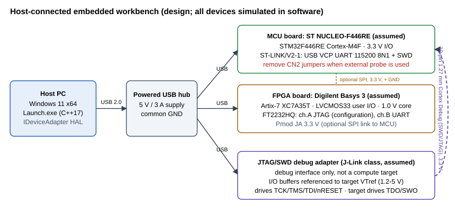

# Embedded system integration design (Task E)

Status: **design + simulated adapters only.** No physical board, wiring, firmware or
FPGA bitstream was used. Every device in the application is a C++ mock and is
labelled "SIMULATED" in the UI, in the API (`"simulated": true`) and in telemetry.

## 1. Goal and scope

A Windows 11 host runs the workbench and talks to three bench devices:

| Role | Assumed part | Why this part |
|---|---|---|
| Microcontroller board | ST NUCLEO F446RE (STM32F446RE, Cortex M4F, 180 MHz) | Common, cheap, on board ST LINK gives USB power, a virtual COM port and a debug probe |
| FPGA board | Digilent Basys 3 (Xilinx Artix 7 XC7A35T) | Single USB cable for power, JTAG configuration and UART through an FTDI FT2232HQ |
| JTAG debug adapter | SEGGER J Link class JTAG/SWD probe | Level shifting referenced to the target, supports JTAG and SWD, standard 20 pin and 10 pin Cortex Debug connectors |

The part numbers are **assumptions for the pinout and voltage tables**. The software
interface (`IDeviceAdapter`) does not depend on them.

## 2. Block diagram



```
            USB 2.0 (data + 5 V)                       UART 115200 8N1 (ST-LINK VCP)
 +-----------+      +----------------+  USB  +-------------------------------+
 | Host PC   |------| Powered USB    |-------| MCU board  NUCLEO-F446RE       |
 | Win 11    |      | hub (5 V/3 A,  |       | 3.3 V logic, CN4 SWD header     |<---+
 | Launch.exe|      | common GND)    |  USB  +-------------------------------+    |
 | C++ HAL   |      |                |-------| FPGA board  Basys 3             |    | 10 pin 1.27 mm
 +-----------+      |                |       | FT2232 ch.A = JTAG (config)     |    | Cortex Debug
                    |                |       | FT2232 ch.B = UART (telemetry)  |    | (SWD/JTAG)
                    |                |  USB  +-------------------------------+    |
                    |                |-------| JTAG/SWD adapter (J-Link class) |----+
                    +----------------+       | VTref sensed from MCU 3.3 V     |
                                             +-------------------------------+
 Optional MCU <-> FPGA link: Pmod JA <-> Morpho header, 3.3 V LVCMOS33, SPI/UART, shared GND.
```

## 3. Interface and pin / voltage table

| Link | Connector (assumed) | Signals | Voltage domain | Level shifting | Owner / direction |
|---|---|---|---|---|---|
| Host to hub | USB A | D+, D-, VBUS, GND | 5 V VBUS, USB differential | n/a | Host |
| Hub to MCU board | USB Mini B (ST LINK) | USB CDC (VCP) + ST LINK debug | 5 V in, on board LDO to 3.3 V | none needed | Host |
| Hub to FPGA board | USB Micro B (J4 PROG/UART) | FT2232 ch.A JTAG, ch.B UART | 5 V in, board regulators to 3.3/1.8/1.0 V | none needed | Host |
| Hub to JTAG probe | USB | vendor USB protocol | 5 V | n/a | Host |
| Probe to MCU | 10 pin 1.27 mm Cortex Debug (via 20 to 10 pin adapter) | VTref, SWDIO/TMS, SWCLK/TCK, SWO/TDO, TDI, nRESET, GND x3 | target 3.3 V | **inside the probe**, referenced to VTref (1.2 to 5 V) | probe drives TCK, TMS, TDI, nRESET; target drives TDO/SWO; SWDIO bidirectional |
| MCU to FPGA (optional) | MCU Morpho CN10 to FPGA Pmod JA | SPI: SCK, MOSI, MISO, CS, GND | both 3.3 V LVCMOS | none (same domain); add 100 to 330 ohm series resistors | MCU is SPI master |
| Telemetry back to host | UART over each board's USB bridge | TX/RX | 3.3 V at the board, USB to host | in board USB bridge | device sends, host polls |

Device specific pinout assumptions (from the vendor user manuals, to be rechecked
against the exact board revision before wiring):

* NUCLEO F446RE: on board ST LINK uses SWDIO = PA13, SWCLK = PA14, SWO = PB3. To let
  an **external** probe drive these pins, remove the two CN2 jumpers so the on board
  ST LINK releases the lines; otherwise two drivers fight on SWCLK/SWDIO.
* Basys 3: FPGA JTAG is wired to FT2232 channel A on the board; it is **not** brought
  out to a header for the external probe in this design. The FPGA is configured over
  its own USB link.
* Pmod JA is 3.3 V only (VCCO of that bank). Never connect a 5 V signal.

## 4. Power, grounding and voltage domains

* Each board is powered from its own USB port through a **powered** hub (5 V, at least
  3 A total) so the laptop port is not overloaded. Basys 3 alone can draw up to about
  1 A during configuration.
* All grounds are common through the USB shields and GND pins. When the optional MCU
  to FPGA link is wired, add a direct GND wire next to the signal wires so the return
  path is short.
* Domains: 5 V (USB VBUS), 3.3 V I/O on both boards, 1.8 V and 1.0 V internal FPGA
  rails, probe I/O follows VTref. No signal in this design crosses between different
  voltages, so no discrete level shifter is required. If a 1.8 V target is ever
  added, the probe still works (VTref follows the target) but the MCU to FPGA link
  would need a level translator such as a TXS0108E.
* Do not back power: never connect the probe's 5 V target supply pin to a board that is
  already USB powered.

## 5. Why a JTAG adapter is not "a third compute board"

A JTAG/SWD adapter is a **debug and programming interface**. It has no user
application of its own; it translates host commands into IEEE 1149.1 TAP state
changes (TCK/TMS/TDI/TDO) or Arm SWD transactions on another chip. It can halt a CPU,
read registers and memory, and program flash, but it only makes sense **attached to
a target**. It does not share a connector, voltage or protocol with the boards: it
uses VTref to match whatever target it is plugged into, and its USB protocol is
vendor specific. That is why the software models it with different capabilities
(VTref, TCK frequency, target IDCODE, scan chain length) instead of the "telemetry
from my firmware" model used for the MCU and FPGA, and why the code never assumes
all devices share a protocol.

JTAG signal ownership rule: exactly one driver per TCK/TMS/TDI net. When the external
probe is attached to the MCU, the on board ST LINK must be isolated (CN2 jumpers off).

## 6. Software architecture

```
UI (Hardware view)  --HTTP JSON-->  http_server.cpp  -->  hw::DeviceManager
                                                          |  discover(), find(), recover()
                                                          v
                                                  hw::IDeviceAdapter (interface)
                                 +----------------+----------------+-----------------+
                                 | MockMicrocontroller | MockFpga  | MockJtagDebugger|
                                 +--------------------- MockDeviceBase (state machine,
                                                         simulated latency and timeout)
```

* `IDeviceAdapter`: `descriptor()`, `capabilities()`, `connect(timeout)`,
  `disconnect()`, `requestTelemetry(timeout)`, `state()`, `lastError()`,
  `injectFault(mode)`.
* State machine: Disconnected to Connected (connect), Connected to Faulted (timeout),
  Faulted to Connected (recover = reset link + reconnect with up to 3 attempts and
  exponential backoff 50, 100, 200 ms).
* Timeout: the mock link answers in 2 to 8 ms. An injected fault makes the simulated
  device stay silent, so the host waits its full deadline (250 ms default) before
  raising `DeviceTimeoutError`. This exercises the same host path a hung firmware or
  pulled cable would. The API maps it to HTTP 504 with `"recoverable": true`.
* A real implementation would replace `MockDeviceBase::exchange()` with a serial port
  (Win32 `CreateFile("\\\\.\\COMx")` + `SetCommTimeouts`) or the vendor's DLL, keeping
  the interface unchanged.

## 7. Safe integration plan (when real hardware is available)

1. Inspect boards, check jumper settings (NUCLEO CN2, Basys 3 JP1 mode = JTAG).
2. Power each board alone from the powered hub; confirm enumeration in Device Manager
   (ST LINK VCP, FTDI dual port, J Link) and measure 3.3 V rails with a multimeter.
3. Talk to each board alone over its own UART with a terminal; flash a minimal
   "telemetry echo" firmware / bitstream.
4. Replace one mock at a time with a real adapter class behind `IDeviceAdapter`;
   keep the mock selectable for regression tests.
5. Only then attach the external probe to the MCU (CN2 jumpers removed, probe powered
   from USB, **target powered first**, VTref reading about 3.3 V before connecting).
6. Wire the optional MCU to FPGA SPI link last, with power off, series resistors,
   and a scope check of the 3.3 V levels.
7. Keep ESD precautions (wrist strap, mat) and never hot plug the debug ribbon.

## 8. Limitations

* No real USB/serial/JTAG traffic; enumeration IDs are the values the real parts
  would report, shown for realism only.
* Telemetry values are pseudo random around plausible nominal values.
* Pinouts come from vendor documentation for the assumed boards and were not
  verified on hardware.
* Recovery covers timeouts only; brown outs, enumeration loss and partial frames
  are not modelled.
